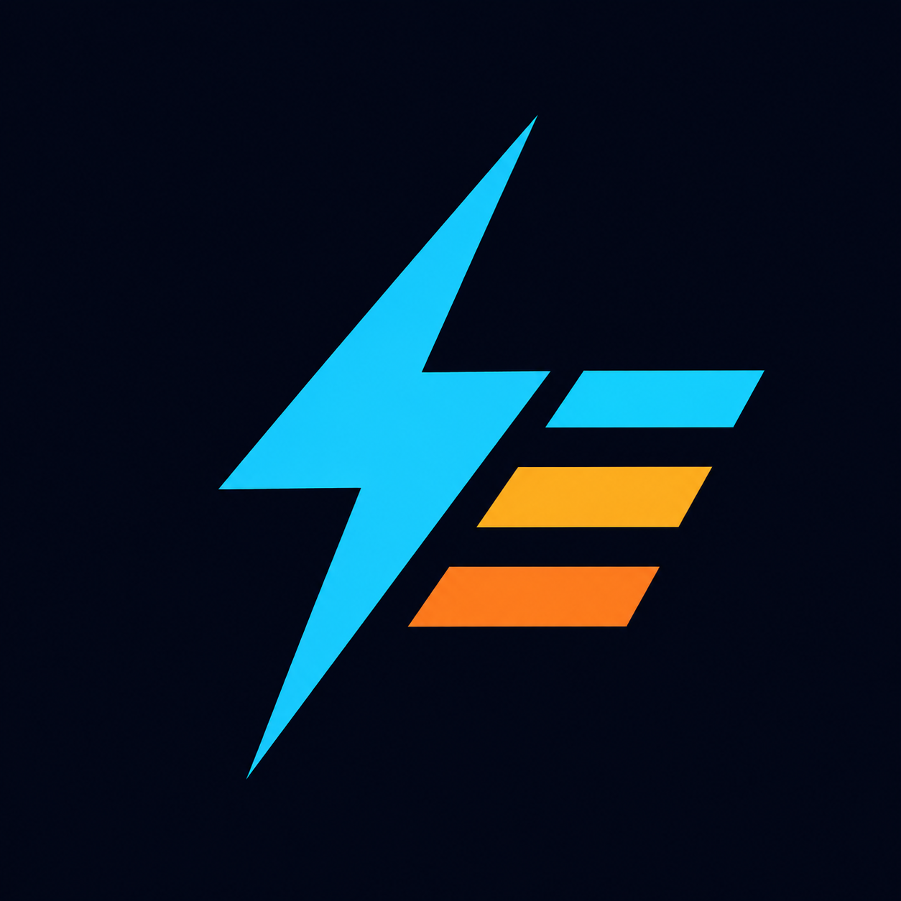
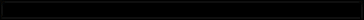
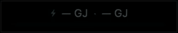

<p align="center">
  
</p>

<h1 align="center">ImpactBar</h1>

<p align="center">
  A native macOS combat-log overlay for EVE Online turret hit quality and energy neutralizer tracking.
</p>

<p align="center">
  <a href="https://github.com/Fatal1ty/ImpactBar/actions/workflows/ci.yml"></a>
  <a href="https://github.com/Fatal1ty/ImpactBar/releases/latest"></a>
  
  
  <a href="LICENSE"></a>
</p>

<p align="center">
  <br>
  <sub>Turret hit-quality overlay</sub>
</p>

<p align="center">
  <br>
  <sub>Energy-neutralizer overlay</sub>
</p>

ImpactBar reads new combat-log lines from `~/Documents/EVE/logs/Gamelogs`. It does not connect to the game process, send commands, collect analytics, or use the network.

## Download

Download the latest macOS archive from [GitHub Releases](https://github.com/Fatal1ty/ImpactBar/releases/latest), unzip it, and move `ImpactBar.app` to `Applications`.

Current public builds are ad-hoc signed because the project does not yet use an Apple Developer ID. On first launch, macOS may block the app. Open **System Settings → Privacy & Security**, locate the ImpactBar message, and choose **Open Anyway**. It may also request access to the Documents folder so it can read EVE logs.

## Features

### Turret hit quality

- A normalized rolling average of the last ten outgoing turret results.
- Continuous color interpolation between fixed hit-quality thresholds.
- A six-pixel activity marker for a zero-value `Miss` without changing the average.
- A short double border pulse for `Wrecks`, which stays outside the average.
- Horizontal or bottom-to-top vertical orientation.
- Automatic resets when the target, character, or game session changes, or after 30 seconds without a turret event.
- Lasers, blasters, railguns, autocannons, artillery, and entropic disintegrators are supported; missiles, drones, and incoming damage are ignored.

### Energy neutralizers

- One compact overlay for one active target at a time.
- The first value is the amount drained during the latest module cycle.
- The second value is the accumulated amount drained from the current target.
- Neutralizer data resets after 10 minutes without a neutralizer event and on undocking. With Hide When Idle disabled, cleared values appear as dashes.
- Three activity segments confirm that new cycles are still being observed without estimating the target's capacitor capacity.
- `DRAINING`, `DRY`, `PINNED`, and `RECOVERED` state detection.
- Positive drains at or below 50% of the current ceiling immediately indicate `PINNED`. A drain can adjust the ceiling or signal recovery only if it reaches at least 75% of the highest single drain observed for the target.
- Support for any number of neutralizer modules. Events within two seconds are grouped for the displayed volley total, while state detection uses each event separately.
- Optional dry and recovered sounds with independent controls.

### Native macOS integration

- Always-on-top overlays, including full-screen EVE.
- Automatic active-log detection and character selection from each log's `Listener` field.
- Independent feature toggles and saved overlay positions.
- Controls for movement, visibility, appearance, testing, orientation, and sounds in the menu-bar app.
- No Dock icon and no persistent main window.

## Usage

1. Launch `ImpactBar.app`.
2. Select the active EVE character from the crosshair menu-bar icon.
3. Enable or disable **Turret Hit Quality** and **Energy Neutralizers** independently.
4. Choose **Move Overlays**, drag the enabled overlays, and choose **Finish Moving Overlays**.
5. Use **Testing → Turret Overlay** or **Testing → Neutralizer Overlay** to preview the UI without entering combat.

ImpactBar starts reading the selected log at its current end, so launching the app or changing characters does not replay earlier combat.

## Troubleshooting

### No characters are listed

Make sure EVE combat logging is enabled and that a game log created within the last 24 hours exists in `~/Documents/EVE/logs/Gamelogs`. Use **Open Logs Folder** from the ImpactBar menu to inspect the directory.

### An overlay is missing

Check that its feature is enabled, choose **Show Overlays**, and use **Reset All Overlay Positions…** if it may be outside the visible screen area.

### Sounds are silent

Check both **Sounds → Enable Sounds** and **Sounds → Neutralizers → Enable Neutralizer Sounds**. Dry and recovered cues can also be enabled and tested independently.

## Build from source

Requirements:

- macOS 13 or later.
- Xcode Command Line Tools with Swift 6 or later.

Build and launch a native-architecture app:

```sh
scripts/build-app.sh
open dist/ImpactBar.app
```

Build an ad-hoc signed universal release archive:

```sh
scripts/package-release.sh
```

Run the test suite:

```sh
swift test --disable-sandbox
```

The release workflow publishes tagged versions as universal macOS archives. Developer ID signing and notarization are intentionally deferred until an Apple Developer Program identity is available.

## Privacy

ImpactBar processes EVE combat logs locally. It does not transmit log contents, collect analytics, or make network requests. Character names are only read from local log headers to let the user choose the active log.

## Contributing

Bug reports and focused pull requests are welcome. See [CONTRIBUTING.md](CONTRIBUTING.md) before submitting a change. Security-sensitive reports should follow [SECURITY.md](SECURITY.md).

## Disclaimer

ImpactBar is an independent, fan-made utility. It is not affiliated with or endorsed by Fenris Creations. Third-party software is used at the player's own risk; review the current [EVE Online third-party policies](https://support.eveonline.com/hc/en-us/articles/8564030965660-Third-Party-Policies) before use.

## License

ImpactBar is available under the [MIT License](LICENSE).
